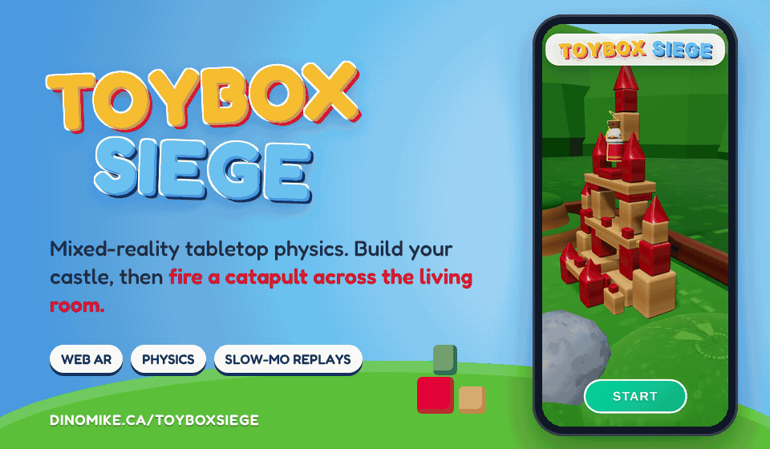

# Toybox Siege



**Mixed-reality tabletop physics. Build your castle, then fire a catapult across the living room.**

Point your phone at a table and a toy-block battlefield appears on it: two castles, hills, mushrooms,
windmills and TNT, with a king on each tower. Pull back the catapult, pick your arc and let go. Every
block is a physics object, so towers topple, crates explode, and a direct hit gets a slow-motion replay.

Created by **Mike Warren** ([@dinosaurmike](https://github.com/dinosaurmike)).

**Play it: <https://dinomike.ca/ToyboxSiege/>** (best on a phone: open it, allow the camera and look at a table)

---

## What it does

**A battlefield on your real table**
- **WebXR AR** on supported Android phones: the arena locks to a real surface you scan.
- Everywhere else (including iPhone), it draws the battlefield over the live camera feed.
- Pick the arena's shape (rectangle, circle or square) and raise or lower it to sit on the table.

**Siege physics**
- A slingshot catapult: **pull back to aim**, with a dotted trajectory preview and a lob-angle slider.
- An ammo rack with boulders, **cluster bombs** and bouncy balls, and reloads between shots.
- Wooden-block castles that break apart, TNT crates, and **0.2× slow-motion replays** of direct hits
  (tap to skip).
- Win by knocking out the other kings: "Victory Royale" for the last king standing.

**Feel**
- Sound effects and gentle haptics (both can be switched off), and a choice of leader: king, queen or
  joker.

**Play together (2 to 4 players)**
- The host places their phone flat on the table as a beacon; friends join by QR code or link and point
  their cameras at it, so everyone shares one battlefield.
- Multiplayer needs the game's small WebSocket relay (`/ws`), which isn't part of this build. On the
  static site at dinomike.ca, the game plays solo.

## How it's built

- A JavaScript web app built with **Vite**: `index.html` plus one bundled module,
  `assets/index-<hash>.js`.
- **Three.js** for the toy world, **WebXR** (`immersive-ar` with hit-testing and a DOM overlay) for AR,
  and a camera-feed fallback (`getUserMedia`) where WebXR AR isn't available.
- A **rigid-body physics engine** in the bundle for the blocks, ammo and explosions.
- Multiplayer messages (arena sync, shots, reloads) go over a WebSocket to the same host at `/ws`.

### What's in this repository

```
index.html          the game (loads assets/)
assets/             the built bundle (Three.js, physics and the game)
docs/images/        README header (GIF) and social preview, with the scripts that make them (source/)
```

This is the **built** game, ready to host. The original source project isn't included here yet.

To run it locally, serve the folder:

```bash
python3 -m http.server 8000
# open http://localhost:8000 on a desktop browser with a webcam
```

Phones only allow the camera on secure (HTTPS) pages, so test on a phone through an HTTPS host or tunnel.

## License

© 2026 Mike Warren. All rights reserved. The code is shared here so you can see the work; it isn't
licensed for reuse. See [LICENSE](LICENSE). Third-party libraries inside the bundle keep their own
licences.
